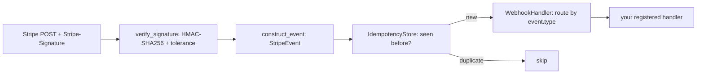

<p align="center">
  
</p>

<h1 align="center">Stripe Webhook Handler</h1>

<p align="center">
  <strong>Idempotent Stripe webhook handler — real signature verification and event routing — in Python.</strong><br>
  Verify the <code>Stripe-Signature</code> header, deduplicate retries, and route each event to a typed handler.
</p>

<p align="center">
  <em>Built and maintained by <a href="https://viprasol.com">Viprasol Tech</a> — Fintech Experts. Full-Stack Builders.</em>
</p>

<p align="center">
  <a href="https://github.com/Viprasol-Tech/stripe-webhook-handler/actions/workflows/ci.yml"></a>
  <a href="LICENSE"></a>
  
  <a href="https://t.me/viprasol_help"></a>
  <a href="https://github.com/Viprasol-Tech/stripe-webhook-handler/stargazers"></a>
</p>

---

> ## ⚠️ Note
> This library implements Stripe's documented webhook signing scheme so you can verify events without the full SDK. It does **not** call the Stripe API. Always keep your endpoint signing secret (`whsec_...`) out of source control, and serve your webhook endpoint over HTTPS. **Use at your own risk** — Viprasol Tech assumes no responsibility for misconfiguration.

---

## ✨ Features

- 🔐 **Real signature verification** — parses `t=...,v1=...`, recomputes `HMAC-SHA256(secret, "timestamp.payload")`, and compares in constant time.
- ⏱️ **Replay protection** — rejects events whose timestamp falls outside a configurable tolerance (default 5 minutes).
- ♻️ **Idempotent by design** — a pluggable `IdempotencyStore` means a redelivered event id is processed exactly once.
- 🧭 **Typed event routing** — register one handler per event type; unknown types are accepted and ignored (no Stripe retries).
- 🧩 **Pluggable storage** — swap the in-memory store for Redis/SQL via a tiny `Protocol`; the dedupe logic is identical.
- 🖥️ **CLI** — `stripe-webhook-handler demo` runs the whole pipeline offline with a self-signed sample event.
- ⚙️ **Modern tooling** — ruff, mypy (strict), pytest, GitHub Actions CI.

## 🚀 Quickstart

```bash
git clone https://github.com/Viprasol-Tech/stripe-webhook-handler.git
cd stripe-webhook-handler
python -m pip install -e ".[dev]"

# Verify + dispatch a sample event offline (valid, duplicate, tampered, expired, unknown):
stripe-webhook-handler demo
```

## 🧩 Use it in your app

```python
from stripe_webhook_handler import WebhookHandler, StripeEvent

handler = WebhookHandler("whsec_your_signing_secret")


@handler.register("checkout.session.completed")
def fulfil_order(event: StripeEvent) -> None:
    session = event.object
    print("Paid:", session["amount_total"], session["currency"])


# In your web framework's webhook route:
def webhook_view(request):
    status = handler.handle(request.body, request.headers["Stripe-Signature"])
    # status is PROCESSED, DUPLICATE, or IGNORED — always return HTTP 200.
    return ("", 200)
```

## 🏗️ Architecture



## 🗺️ Roadmap

- [x] Signature verification with constant-time compare and replay tolerance
- [x] In-memory idempotency store + pluggable `Protocol`
- [x] Typed per-event-type routing with duplicate/unknown handling
- [ ] Redis and SQL idempotency stores
- [ ] ASGI/WSGI adapters (FastAPI, Flask, Django) as optional extras
- [ ] Async dispatch and background-task hand-off

## 🤝 Contributing

PRs welcome — see [CONTRIBUTING.md](CONTRIBUTING.md) and our [Code of Conduct](CODE_OF_CONDUCT.md).

## Contact — Viprasol Tech Private Limited

- Website: [viprasol.com](https://viprasol.com)
- Email: [support@viprasol.com](mailto:support@viprasol.com)
- Telegram: [t.me/viprasol_help](https://t.me/viprasol_help) | WhatsApp: +91 96336 52112
- GitHub: [@Viprasol-Tech](https://github.com/Viprasol-Tech) | [LinkedIn](https://www.linkedin.com/in/viprasol/) | X [@viprasol](https://twitter.com/viprasol)

## License

[MIT](LICENSE) (c) 2025 Viprasol Tech Private Limited
